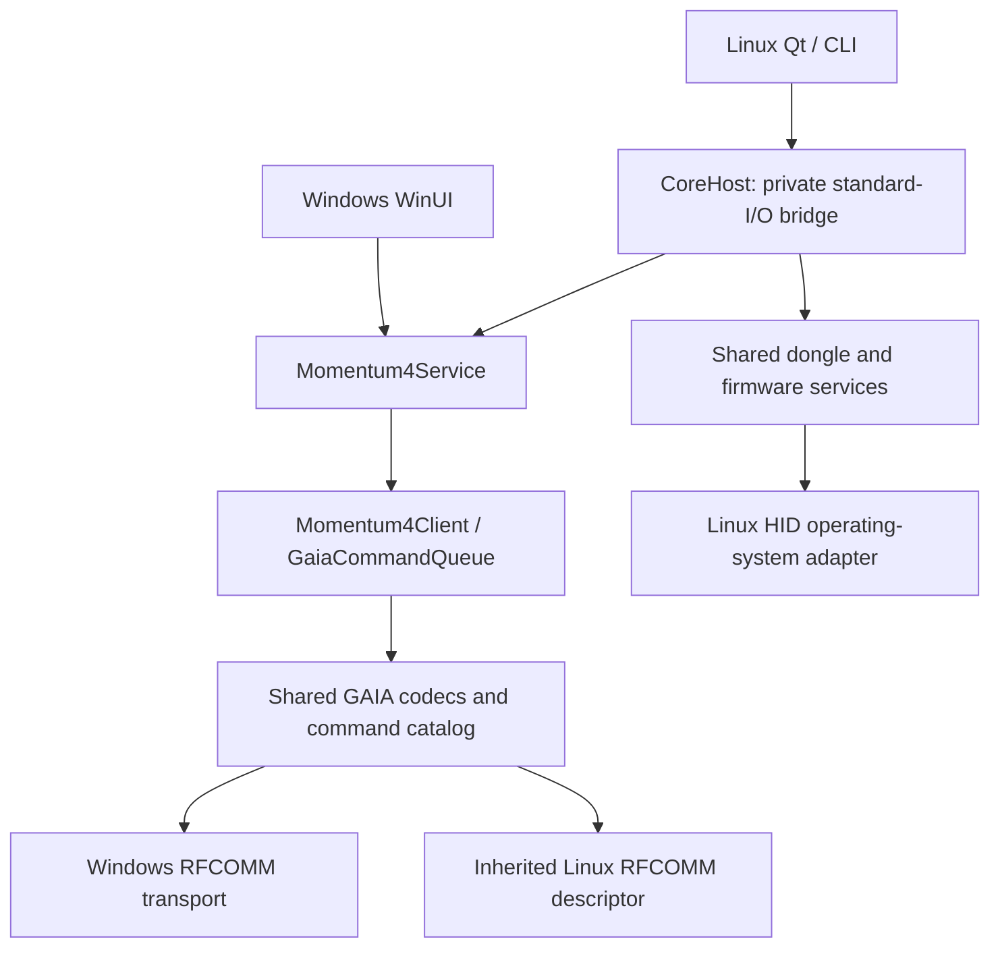

# Shared device core

Windows and Linux use `Momentum4.Core` and `Momentum4.Protocol` for device behavior. The Windows application calls the libraries directly. The Linux Qt frontend calls the same libraries through a private self-contained process, `momentum-core-host`.



## Responsibilities

| Location | Owns |
| --- | --- |
| `src/Momentum4.Protocol` | GAIA framing, command definitions, reply codecs, dongle reports, HID descriptor and firmware image validation |
| `src/Momentum4.Core` | Model/firmware capabilities, fresh snapshots, serialized controls, readback, EQ transactions, peers, codec changes and firmware preparation/transfer |
| `src/Momentum4.Bluetooth` | Windows Bluetooth discovery and byte transport |
| `src/Momentum4.App` | Windows presentation and desktop integration |
| `src/Momentum4.CoreHost` | Typed private IPC, inherited descriptor transport, OS-operation bridge and process lifecycle |
| `linux/momentum_control/bluez.py` | Paired GAIA discovery, BlueZ profile/private bus, RFCOMM acquisition and device lease ownership |
| `linux/momentum_control/hidraw.py` | Linux discovery/identity checks, device locks, safe descriptor opening and bounded raw HID syscalls |
| `linux/momentum_control/core_proxy.py` and backend facades | Process ownership, cancellation, bounded messages and presentation DTO mapping |
| Remaining Linux UI/application modules | Qt widgets, gestures and pending edits, local preferences/presets, GeoClue and local comparison/zone workflows |

Python does not implement GAIA frames, headset command IDs, firmware/model write gates, report/image parsing or hardware write transactions. CoreHost is an adapter, not another device implementation. Existing Windows service methods remain compatibility wrappers over the shared control operations. Windows' strength-to-Custom workflow and its legacy EQ rollback option are explicit operation choices within the same core.

## State and lifecycle

`HeadsetControlSnapshot` contains typed nullable values and capabilities derived from fresh device observations. A failed optional read revokes its value and capability. Malformed input, timeout or lost identity invalidates the session. No frontend's checkbox state, cached value or device alias grants permission to write.

Legacy Windows display state may retain last-known values after a failed background read. Those values never authorize a write: every action uses the fresh shared transaction path. Polling and complete transactions serialize. Linux disables Core's autonomous polling and uses its existing Qt refresh scheduler; the host also disables serial-number reads and notification registration.

Linux owns one helper per headset connection. It passes only the already-open RFCOMM descriptor at process creation and keeps the BlueZ profile and device lease alive. A disconnected descriptor is terminal; reconnect creates a new lease and helper. A separate retained dongle helper keeps at most one prepared immutable firmware image. A sequential private plan handle expires after ten minutes and is consumed on application; the frontend never supplies firmware bytes, URLs or reconstructed provenance.

The helper has no network listener or root service. Standard-I/O messages are versioned, bounded and strictly validated. A single active request and one bounded transition slot prevent work accumulation. EOF, invalid messages, cancellation and deadlines end the session; the parent terminates and reaps the child. Progress precedes its terminal response, including under output backpressure.

The Linux adapter pumps BlueZ callbacks on its owning worker during waits and while idle. Cancellation stops the helper promptly. An in-flight kernel HID feature ioctl cannot be interrupted by a userspace timeout; its descriptor/lease remains owned until the syscall returns, then cleanup runs once. It must not be closed or reused by another thread. Native firmware flashing/recovery and real location entry/exit remain outside automated verification.

## Adding a device feature

1. Record independently observed protocol facts and sanitized hardware evidence. Keep unverified writes disabled; manufacturer code/assets are not contribution material.
2. Add the command and codec in `Momentum4.Protocol`, including bounded rejection cases.
3. Add its typed state/control and model/firmware capability in Core. Implement the read/write/readback transaction once in `Momentum4Service`; preserve related settings and one total operation budget.
4. Add shared tests for supported and unsupported models, malformed replies, rejected/uncertain writes, stale identity and relevant sibling effects. A mutation of each decisive guard must fail behaviorally.
5. Expose the typed result through CoreHost and add presentation controls in the frontends that need it. Both call the same operation. Do not add Python command formats or duplicate a Windows setter algorithm.

Dongle features follow the same boundary: report codecs and policy in Protocol/Core; OS adapters only acquire the bound device and perform raw I/O. Codec and firmware tests use fake endpoints, HTTP and time. A passing simulated firmware transfer does not establish physical recovery support.

## Build and verification

The repository pins the SDK in `global.json`. Build the Linux helper with `./linux/build.sh`, then run `./linux/install.sh`. `MOMENTUM_DOTNET` can select an SDK executable for development. The installed self-contained helper needs no separately installed .NET runtime; the build requires the SDK. Build output under `linux/core/` is ignored by Git.

```sh
dotnet test --project tests/Momentum4.Protocol.Tests/Momentum4.Protocol.Tests.csproj -c Release
dotnet test --project tests/Momentum4.Core.Tests/Momentum4.Core.Tests.csproj -c Release
dotnet test --project tests/Momentum4.CoreHost.Tests/Momentum4.CoreHost.Tests.csproj -c Release
./linux/build.sh
PYTHONPATH=linux QT_QPA_PLATFORM=offscreen python3 -m unittest discover -s linux/tests -v
```

Core/Protocol tests carry hardware semantics and captured exchanges. Python tests cover the OS boundary, GUI/CLI and the real child-process chain. Installer tests check ownership, binary bounds, executable mode, rollback and complete removal. Windows-native UI/build verification requires a Windows runner; portable shared-core tests alone do not establish it.
